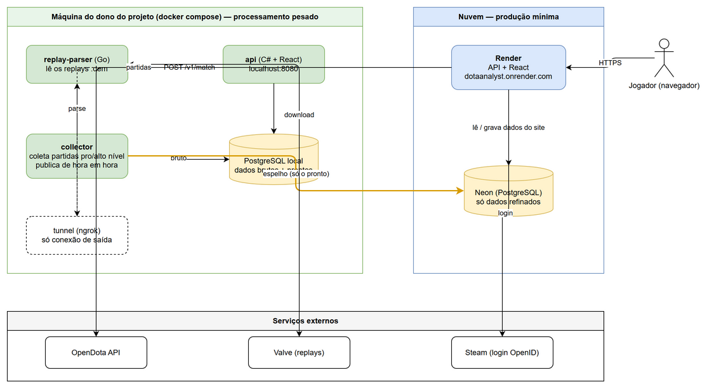
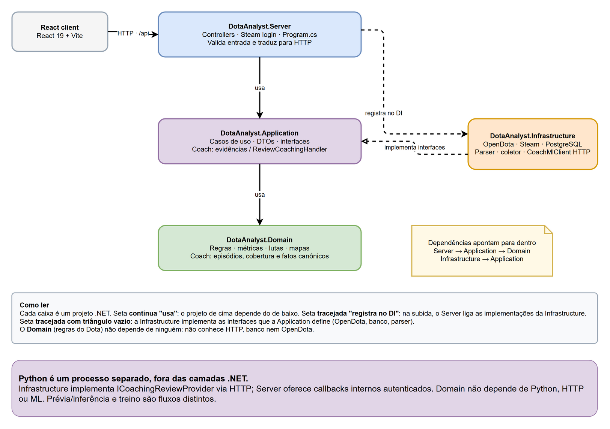
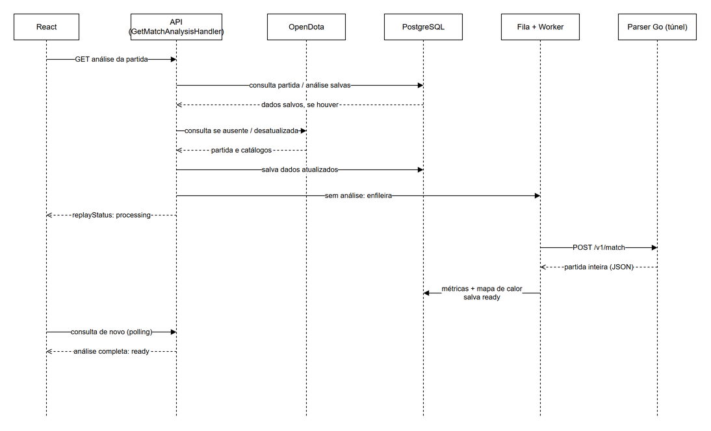
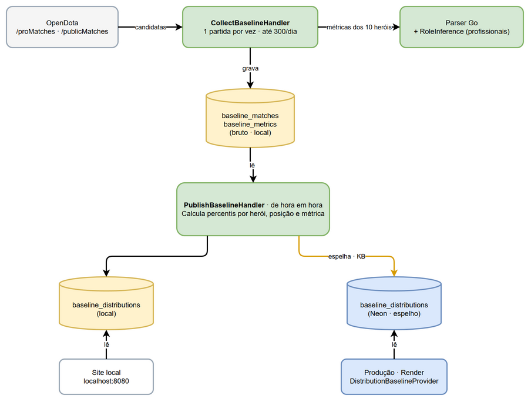
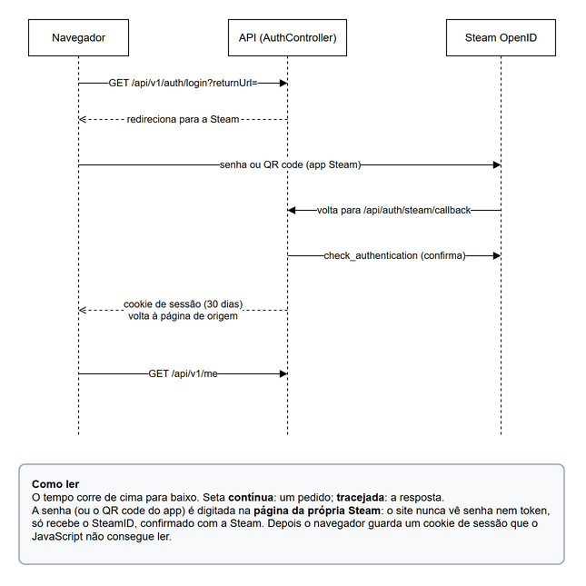
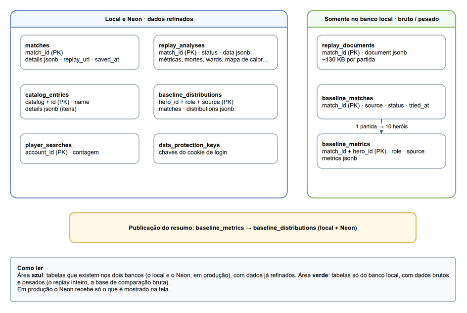

# DotaAnalyst

[](https://github.com/andreomorg/dota_analyst/actions/workflows/ci.yml)

Analisador de partidas de Dota 2. Entre com a sua conta Steam (senha ou QR code no app Steam) — ou informe qualquer account ID do Dota/SteamID64 — e veja as partidas recentes e uma análise de cada uma, com dados do [OpenDota](https://www.opendota.com) e com o que o próprio projeto lê do **replay** da partida.

**No ar:** https://dotaanalyst.onrender.com (plano grátis do Render: o primeiro acesso depois de 15 min parado demora ~1 min).

## O que a análise mostra

A página de uma partida abre com o placar dos dois times e é dividida em **abas** (cada uma com o próprio endereço, `?tab=`, para compartilhar ou abrir em outra aba do navegador):

| Aba | O que tem |
|---|---|
| **Visão geral** | O mais importante primeiro: os 3 destaques (ponto forte, ponto de atenção, fase de rotas), seu desempenho em números grandes (K/D/A, participação em abates, GPM/XPM, dano, patrimônio…), o gráfico de como a partida andou e atalhos para as outras abas. |
| **Dicas** | O que melhorar — mortes sem aliado por perto, morrer logo depois de voltar, trocas perdidas na rota, presença nas lutas, visão… —, comparado com o adversário da mesma posição, com a média da partida e com **jogadores profissionais e de alto nível** do mesmo herói e posição; e os percentis do OpenDota contra outros jogadores do herói. |
| **Fase de rotas** | Até 10:00: sua rota, quem ganhou, last hits, patrimônio e experiência de quem estava nela, e o gráfico só da sua rota. |
| **Itens** | Itens iniciais e a linha do tempo de quando cada item ficou pronto. |
| **Economia e objetivos** | Vantagem de patrimônio/experiência com torres, barracks, Roshan e Tormentor marcados, e o placar de objetivos. |
| **Lutas e dano** | Cada luta com o resultado e a sua participação; dano causado e recebido por herói e por habilidade/item. |
| **Mapas** | Sobre o minimapa do jogo: **mapa de calor** de onde você passou o tempo vivo (como os de futebol), ao lado do adversário da mesma posição, por período e com as suas mortes; onde você morreu; os wards dos dois times. |
| **Jogadores** | Os 10 jogadores, com itens finais. |

O visual segue o design "Obsidian Telemetry" feito no Google Stitch (tema escuro, números em fonte mono, verde/vermelho para bom/ruim, violeta para "você"), com as fontes servidas pelo próprio site.

## Como funciona

```
                    máquina do dono do projeto (docker compose)              nuvem
 ┌──────────────────────────────────────────────────────────┐
 │ replay-parser (Go) — lê os replays (.dem) da Valve        │◄── túnel ngrok ── API no Render
 │ collector — coleta partidas pro/alto nível,               │                    (só lê dado pronto)
 │             base bruta no PostgreSQL local,               │                        │
 │             publica de hora em hora só o resultado ───────┼──► Neon (PostgreSQL) ◄─┘
 │ api + PostgreSQL local — o mesmo site, para ver tudo      │    espelho: só dados refinados
 │                          funcionando de perto             │
 └──────────────────────────────────────────────────────────┘
```

- **O processamento pesado fica na máquina do dono do projeto:** ler replays (dezenas de MB cada), coletar milhares de partidas, calcular distribuições, guardar os documentos brutos. **O Neon guarda só o que é mostrado, já refinado** — a base de comparação, por exemplo, ocupa alguns KB lá, por maior que seja a coleta local; o mapa de calor de uma partida são poucos KB (uma grade de 32 × 32 por fase do jogo), nunca as posições cruas. O site local lê as mesmas tabelas prontas que a produção: o que aparece em `localhost` é o que vai ao ar.
- **A base de comparação cresce onde faz falta:** o coletor olha os heróis das últimas 20 partidas da conta foco e, enquanto algum tiver menos de 10 partidas de alto nível na base, busca primeiro partidas com esses heróis (o de menos dados antes); depois volta às profissionais.
- Com essa máquina desligada o site continua no ar: o que já foi analisado aparece normalmente; replays novos ficam "indisponíveis" até ela voltar.
- Dados: [OpenDota](https://www.opendota.com) (API pública) e replays dos servidores da Valve. O minimapa e os retratos/ícones de heróis e itens são arte do próprio Dota 2, servida localmente; projeto de fã, não comercial. Rever os direitos antes de monetizar.

## Tecnologias

- **Back-end:** ASP.NET Core (.NET 10) em DDD — `Domain` (regras do Dota), `Application` (casos de uso), `Infrastructure` (OpenDota, Steam, banco, parser, coletor) e `Server` (API).
- **Banco:** PostgreSQL com EF Core — local no Docker; [Neon](https://neon.tech) em produção.
- **Front-end:** React 19 + Vite, CSS próprio (sem framework), gráficos e mapas em SVG/canvas feitos à mão.
- **Leitura de replays:** serviço próprio em Go (`replay-parser/`).
- **Login:** Steam OpenID — o site nunca vê senha nem token; recebe só o SteamID.
- **Testes e entrega:** xUnit (com PostgreSQL real via [Testcontainers](https://dotnet.testcontainers.org)) e testes Go; GitHub Actions (CI e publicação da imagem `ghcr.io/andreomorg/dota_analyst`).

## Rodando com Docker

Precisa só do [Docker](https://www.docker.com/products/docker-desktop/).

```sh
cp .env.example .env   # preencha POSTGRES_PASSWORD e REPLAY_PARSER_API_KEY (instruções no arquivo)
docker compose up --build
```

Abra http://localhost:8080. Sobem a API (com o React embutido), o PostgreSQL e o parser de replays. Para parar: `docker compose down` (os dados do banco ficam no volume `db-data`; `docker compose down -v` apaga tudo).

O `.env` define a porta da aplicação (`API_PORT`), a senha do PostgreSQL local (`POSTGRES_PASSWORD`, obrigatória), o token entre a API e o parser (`REPLAY_PARSER_API_KEY`, obrigatório), a porta do banco na sua máquina (`POSTGRES_PORT`, só em 127.0.0.1) e, opcionalmente, a [Steam Web API key](https://steamcommunity.com/dev/apikey) (`STEAM_API_KEY`) para mostrar nome e avatar de quem está logado. O login com a Steam funciona também em `http://localhost:8080`.

Serviços opcionais, ligados por perfil (`COMPOSE_PROFILES` no `.env`, ex. `tunnel,collector`):

- **`tunnel`** — túnel ngrok para a produção usar o parser desta máquina (`NGROK_AUTHTOKEN`, `NGROK_URL`).
- **`collector`** — coletor da base de comparação: parseia partidas profissionais e de alto nível, guarda o bruto no PostgreSQL local e publica o resultado (`COLLECTOR_FOCUS_ACCOUNT_ID`; `COLLECTOR_TARGET_PER_HERO`, padrão 10, e `COLLECTOR_DAILY_LIMIT`, padrão 600; `MIRROR_DATABASE` para publicar também no Neon).

## Rodando para desenvolver

Precisa do .NET 10 SDK, do Node.js 24, do Go e do Docker (para o PostgreSQL e o parser).

1. Suba o banco e o parser: `docker compose up -d db replay-parser`.
2. Uma vez, diga à API onde está o banco (fica no user-secrets, fora do Git):
   ```sh
   dotnet user-secrets set "ConnectionStrings:Database" "Host=localhost;Port=5432;Database=dotaanalyst;Username=dotaanalyst;Password=<POSTGRES_PASSWORD do .env>" --project DotaAnalyst.Server
   ```
3. **VS Code:** F5 → **"API + React"** (configuração em `.vscode/`). **Visual Studio 2026:** abra `DotaAnalyst.slnx` e aperte F5. **Linha de comando:** `dotnet run --project DotaAnalyst.Server` — o Vite é iniciado automaticamente.

A aplicação abre em https://localhost:59438 (API em https://localhost:7208). Na primeira vez, confie no certificado de desenvolvimento: `dotnet dev-certs https --trust`. As tabelas são criadas sozinhas quando a API sobe (migrations). Documentação da API (só em Development): https://localhost:59438/api/docs.

Para olhar o banco, use o pgAdmin (ou outro cliente): servidor `localhost`, porta `5432`, banco/usuário `dotaanalyst`, senha do `.env`.

**Testes:** `dotnet test` (os testes do banco sobem um PostgreSQL descartável no Docker, então o Docker precisa estar rodando) e `go test ./...` em `replay-parser/`.

**Mudou uma entidade ou tabela?** Crie uma migration:

```sh
dotnet ef migrations add <Nome> --project DotaAnalyst.Infrastructure --startup-project DotaAnalyst.Infrastructure --output-dir Persistence/Migrations
```

(`dotnet tool restore` instala o `dotnet-ef` na primeira vez.)

## Estrutura

| Pasta | O que tem |
|---|---|
| `DotaAnalyst.Domain/` | Regras do Dota: partidas, métricas, regiões do mapa, mapa de calor, lutas, build, comparações |
| `DotaAnalyst.Application/` | Casos de uso e interfaces do que vem de fora |
| `DotaAnalyst.Infrastructure/` | OpenDota, Steam, PostgreSQL, cliente do parser, coletor |
| `DotaAnalyst.Server/` | API (`/api/v1/...`), login com a Steam, `Program.cs` |
| `DotaAnalyst.Tests/` | Testes .NET, uma pasta por camada |
| `dotaanalyst.client/` | Front-end React (`src/analysis/` as abas da análise, `src/ui/` peças comuns, `src/index.css` cores e fontes do design) |
| `replay-parser/` | Serviço Go que lê os replays (`POST /v1/match`) |

Regras de arquitetura, decisões e detalhes de cada parte: [`CLAUDE.md`](CLAUDE.md) e [`replay-parser/CLAUDE.md`](replay-parser/CLAUDE.md).

## Diagramas

Os diagramas abaixo são exibidos diretamente no README. O arquivo-fonte editável está em [`docs/diagrams/dotaanalyst.drawio`](docs/diagrams/dotaanalyst.drawio) e pode ser aberto no draw.io.

### Arquitetura



### Camadas DDD



### Fluxo da análise



### Base de comparação



### Login com a Steam



### Banco de dados



## Versões e publicação

Versionamento semântico (`vMAJOR.MINOR.PATCH`; o MAJOR acompanha a versão da API, `/api/v1`). Uma tag `v*` no `main` roda os testes, publica a imagem no ghcr.io e faz o deploy no Render.
