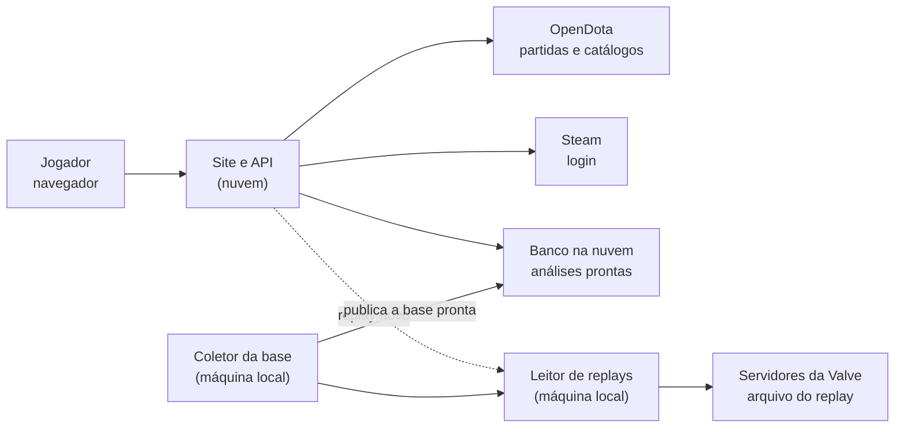
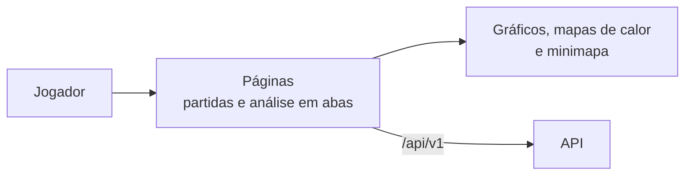
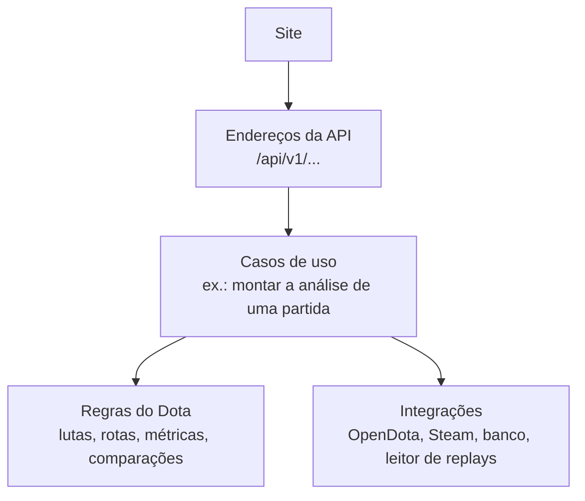
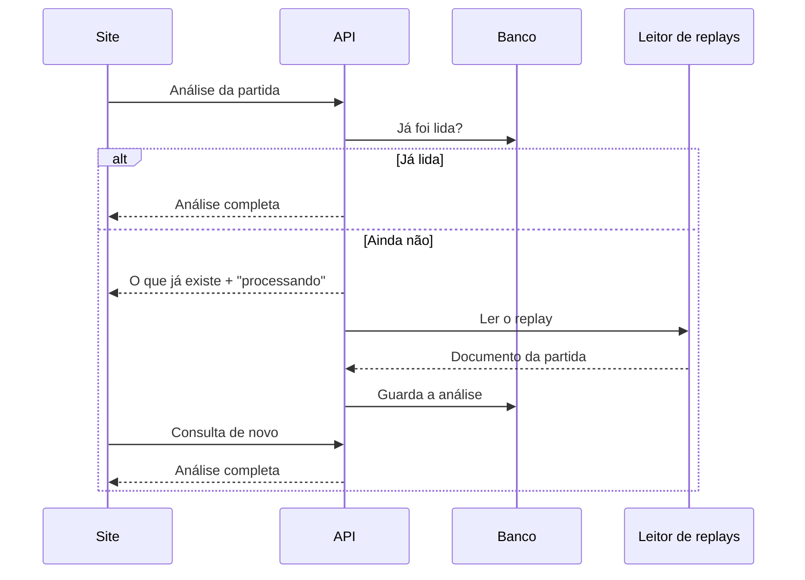
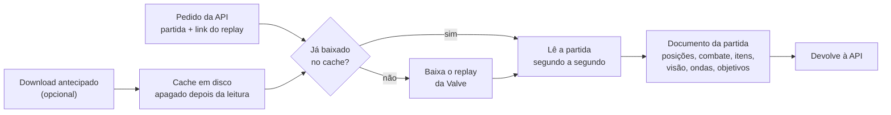
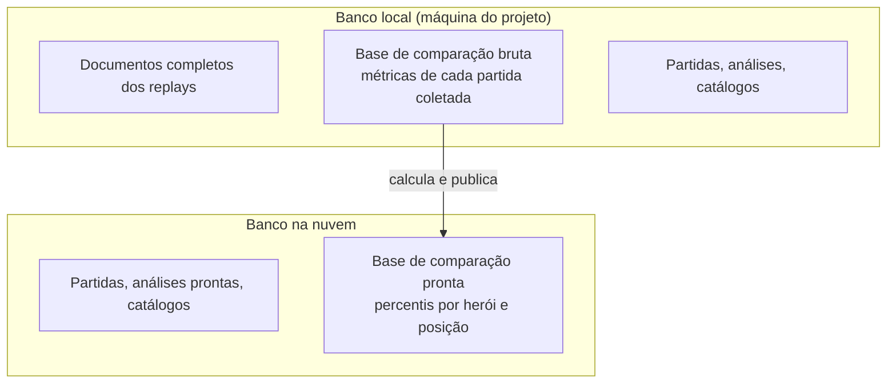
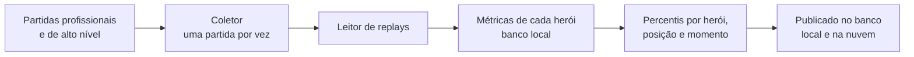
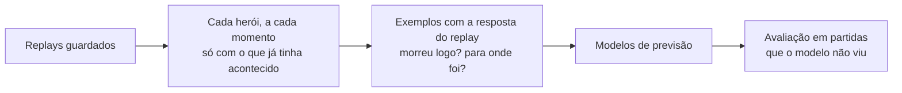
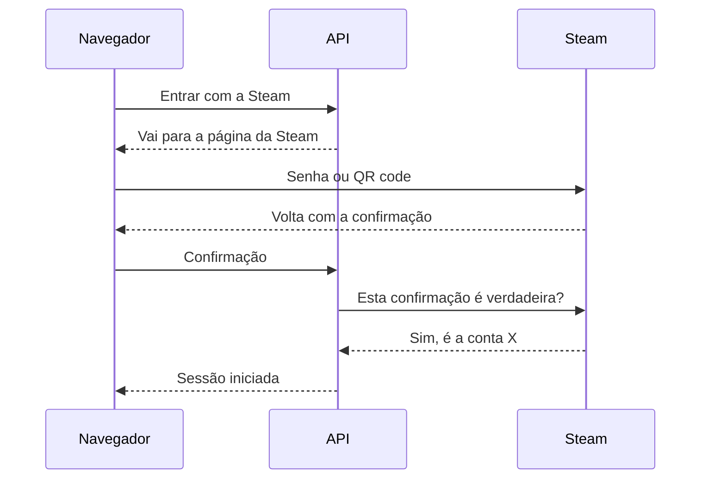

# DotaAnalyst

[](https://github.com/andreomorg/dota_analyst/actions/workflows/ci.yml)
[](https://github.com/andreomorg/dota_analyst/actions/workflows/coach-ml.yml)

Analisador de partidas de Dota 2. Entre com a sua conta Steam — ou digite qualquer account ID do Dota — e veja as suas partidas recentes e uma análise de cada uma: como foi a rota, onde você morreu, como andou a economia, as lutas, a build e o que dá para melhorar. Os dados vêm do [OpenDota](https://www.opendota.com) e do próprio **replay** da partida, que o projeto baixa e lê por conta própria.

**Demonstração:** https://dotaanalyst.onrender.com (plano gratuito: o primeiro acesso depois de um tempo parado pode demorar cerca de um minuto).

## O que a análise mostra

A página de uma partida é dividida em abas, cada uma respondendo a uma pergunta:

| Aba | Pergunta |
|---|---|
| **Resumo** | Como foi a partida e como eu fui, em poucos números? |
| **Como melhorar** | O que eu posso fazer diferente, e onde estão os números que mostram isso? |
| **Fase de rotas** | Como foram os primeiros 10 minutos na minha rota, contra quem? |
| **Posicionamento** | Por onde eu andei, onde morri e que visão o time tinha? |
| **Lutas e objetivos** | Em que lutas eu estive, quanto dano troquei, quais torres e Roshans caíram? |
| **Build** | O que eu comprei, quando, e em que ordem subi as habilidades? |
| **Jogadores** | Como foram os dez jogadores, lado a lado? |

Os números são comparados com jogadores do **mesmo herói e da mesma posição** — profissionais e partidas de alto nível — em qualquer momento da partida.

## Como funciona

O site e a API ficam na nuvem; o trabalho pesado (baixar e ler replays, coletar partidas para comparação) roda numa máquina local, que entrega à nuvem só o resultado pronto. Se essa máquina estiver desligada, o site continua no ar com tudo o que já foi analisado.



Cada parte é um serviço separado, com uma função só:

### Site (React)

É o que o jogador vê: a lista de partidas e a análise em abas, com gráficos e mapas desenhados pelo próprio site sobre o minimapa oficial do jogo. Ele só conversa com a API — nunca chama o OpenDota, a Steam ou o leitor de replays diretamente.



### API (C#)

O centro do sistema. Recebe os pedidos do site, busca a partida no OpenDota, guarda no banco, pede a leitura do replay quando ele ainda não foi lido e transforma tudo isso na análise. As regras do Dota (quem venceu, o que é uma luta, o que conta como morte isolada, como comparar com a base) ficam numa camada própria, separada de banco e de internet, para poderem ser testadas sozinhas.



Quando um replay ainda não foi lido, a análise responde na hora com o que já existe e marca o replay como "em processamento"; o site consulta de novo até ele ficar pronto.



### Leitor de replays (Go)

Baixa o arquivo do replay dos servidores da Valve e o lê do começo ao fim, como se assistisse à partida: a posição de cada herói a cada 2 segundos, vida e mana, itens, habilidades, abates, dano, wards, ondas de creeps, torres, runas e acampamentos. O resultado é um documento único da partida, que a API usa para montar a análise.

Quando muitos replays são processados de uma vez (por exemplo, para atualizar todos os documentos guardados), o download pode ser feito **antes**, num cache em disco: enquanto uns replays são lidos, os próximos já estão baixando, e a leitura não fica esperando a internet.



### Banco de dados (PostgreSQL)

Há dois bancos com papéis diferentes. O **local** guarda tudo, inclusive os documentos completos dos replays, para que análises novas não precisem baixar o replay de novo. O **da nuvem** guarda só o que o site mostra: partidas, análises prontas, catálogos e a base de comparação já calculada.



### Base de comparação (coletor)

Para dizer se um número é bom ou ruim, o projeto compara com outros jogadores do mesmo herói e posição. Um coletor, na máquina local, busca partidas profissionais e de alto nível, lê os replays e guarda as métricas de cada herói. De hora em hora ele transforma isso em percentis ("à frente de X em cada 100") e publica só esse resultado. Ele prioriza os heróis que o dono da conta mais joga e que ainda têm poucos dados.



### Modelos de previsão e coach (Python)

Uma frente experimental, que ainda não aparece no site. A partir dos replays guardados, o projeto descreve cada herói a cada momento só com o que tinha acontecido até ali — posição, vida, ondas, torres, quem está por perto, o que cada inimigo pode fazer, o que o time enxerga — e treina modelos que aprendem com o próprio replay: "este herói morreu nos 15 segundos seguintes?" e "para onde ele foi?". Um coach com modelo de linguagem está em teste à parte. As dicas do site continuam vindo das regras atuais.



Detalhes do fluxo de dados, treino e avaliação: [coach-ml/README.md](coach-ml/README.md).

### Login com a Steam

O login usa a página oficial da Steam (senha ou QR code no app). O site nunca vê a senha: a Steam só confirma qual é a conta, e o site guarda um cookie de sessão.



## Rodando

### Com Docker

Precisa só do [Docker](https://www.docker.com/products/docker-desktop/).

```sh
cp .env.example .env   # preencha POSTGRES_PASSWORD e REPLAY_PARSER_API_KEY (instruções no arquivo)
docker compose up --build
```

Abra http://localhost:8080. Sobem a API com o site, o banco e o leitor de replays. Para parar: `docker compose down` (`-v` apaga também os dados do banco).

Serviços opcionais, ligados por perfil (`COMPOSE_PROFILES` no `.env`, ex. `tunnel,collector`):

- **`collector`** — o coletor da base de comparação.
- **`tunnel`** — deixa a produção usar o leitor de replays desta máquina.
- **`coach-ml`** — o serviço Python do coach (experimental).

As variáveis de cada perfil estão comentadas no `.env.example`.

### Para desenvolver

Precisa do .NET 10 SDK, Node.js 24 e Docker (para o banco); Go para mexer no leitor de replays e Python 3.11+ para o coach.

1. `docker compose up -d db`
2. Uma vez: `dotnet user-secrets set "ConnectionStrings:Database" "Host=localhost;Port=5432;Database=dotaanalyst;Username=dotaanalyst;Password=<POSTGRES_PASSWORD>" --project DotaAnalyst.Server`
3. VS Code: F5 → **"API + React"**. Visual Studio: abra `DotaAnalyst.slnx` e F5.

O site abre em https://localhost:59438. Testes: `dotnet test DotaAnalyst.Tests` (raiz), `go test ./...` (`replay-parser/`), `npm run lint` e `npm run build` (`dotaanalyst.client/`), `python -B -m unittest discover -s coach-ml/tests` (raiz).

## Estrutura

| Pasta | O que tem |
|---|---|
| `dotaanalyst.client/` | Site (React) |
| `DotaAnalyst.Server/` | API: endereços, login com a Steam |
| `DotaAnalyst.Application/` | Casos de uso |
| `DotaAnalyst.Domain/` | Regras do Dota |
| `DotaAnalyst.Infrastructure/` | OpenDota, Steam, banco, leitor de replays, coletor |
| `DotaAnalyst.Tests/` | Testes da API |
| `replay-parser/` | Leitor de replays (Go) |
| `coach-ml/` | Modelos de previsão e coach (Python) |
| `docs/diagrams/` | Índice dos diagramas deste README |

Regras de arquitetura e detalhes técnicos: [`CLAUDE.md`](CLAUDE.md), [`replay-parser/CLAUDE.md`](replay-parser/CLAUDE.md) e [`coach-ml/README.md`](coach-ml/README.md).

## Dados e créditos

Partidas e catálogos de heróis/itens: [OpenDota](https://www.opendota.com) (API pública). Replays: servidores da Valve. O minimapa e os ícones de heróis e itens são arte do Dota 2, usados num projeto de fã sem fins comerciais.

Versões seguem `vMAJOR.MINOR.PATCH`; publicar uma tag de versão roda os testes e atualiza o site.
