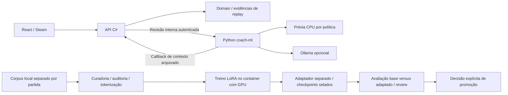
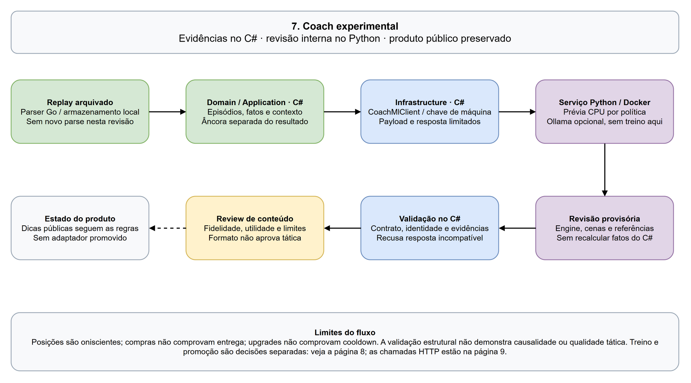
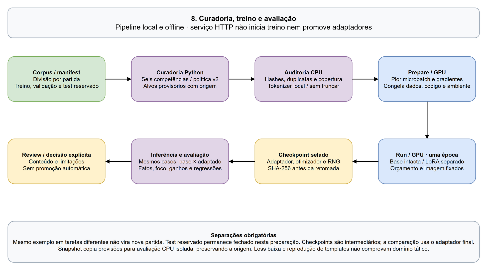
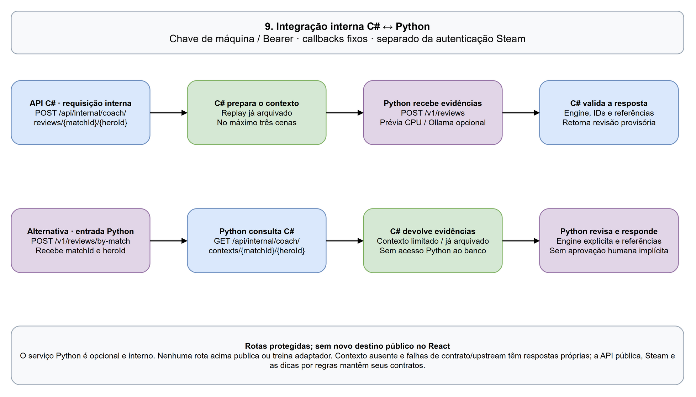

# DotaAnalyst

[](https://github.com/andreomorg/dota_analyst/actions/workflows/ci.yml)
[](https://github.com/andreomorg/dota_analyst/actions/workflows/coach-ml.yml)

Analisador de partidas de Dota 2. Entre com a sua conta Steam (senha ou QR code no app Steam) — ou informe qualquer account ID do Dota/SteamID64 — e veja as partidas recentes e uma análise de cada uma, com dados do [OpenDota](https://www.opendota.com) e com o que o próprio projeto lê do **replay** da partida.

**No ar:** https://dotaanalyst.onrender.com (plano grátis do Render: o primeiro acesso depois de 15 min parado demora ~1 min).

## O que a análise mostra

A página de uma partida abre com o placar dos dois times e é dividida em **abas** (cada uma com o próprio endereço, `?tab=`, para compartilhar ou abrir em outra aba do navegador):

| Aba | O que tem |
|---|---|
| **Resumo** | Destaques, desempenho, gráfico de vantagem dos times e atalhos para os assuntos da partida. |
| **Como melhorar** | Dicas das regras atuais, com links para os números que as sustentam, e percentis do OpenDota. O coach com LLM continua experimental. |
| **Fase de rotas** | Resultado da rota, métricas, gráfico por estatística até 15 minutos e mapa de calor de 0–10 minutos. |
| **Posicionamento** | Mapa de calor após a fase de rotas, mortes, wards e indicadores de posicionamento e visão. |
| **Lutas e objetivos** | Lutas detectadas, participação, dano causado/recebido e eventos de objetivos. |
| **Build** | Itens iniciais e compras, evolução econômica e ordem observada de habilidades. |
| **Jogadores** | Os dez jogadores, itens finais e comparação de estatísticas minuto a minuto. |

As comparações com profissionais e jogadores de alto nível do mesmo herói e posição ficam na aba do respectivo assunto, com seleção de momento quando disponível. Abas dependem dos dados existentes e do estado de processamento do replay.

O visual segue o design "Obsidian Telemetry" feito no Google Stitch (tema escuro, números em fonte mono, verde/vermelho para bom/ruim, violeta para "você"), com as fontes servidas pelo próprio site.

## Coach com modelo de linguagem — experimental

O backend inclui um fluxo experimental para a aba **Como melhorar**, integrado por rotas internas entre a API C# e o serviço Python. O frontend público continua usando as dicas das regras existentes.

- **Fatos verificáveis:** episódios de mortes e lutas, cobertura das posições e distinção entre situação confirmada e desconhecida. Horários e distância ao aliado observado são calculados pelo código, com os instantes das amostras preservados.
- **Dois caminhos experimentais:** seleção restrita de achados/exercícios por IDs, com texto factual montado pela aplicação; e geração de hipóteses condicionais, alternativas e exercícios a partir de um contexto anterior ao evento. Referências válidas não garantem que o texto livre esteja correto.
- **Observação separada da hipótese:** o contrato experimental de reflexão v2 mantém números e classificação na observação determinística. Posições oniscientes não representam visão, intenção ou recursos disponíveis ao jogador; o resultado posterior fica separado dos fatos na âncora de revisão.
- **Aprendizado avaliado, sem promoção:** o experimento factual LoRA no Qwen3-0.6B concluiu uma época com 159.335 exemplos de 968 partidas. Em 288 casos de 96 partidas separadas, o adaptador reproduziu os alvos provisórios em 288/288; o modelo base acertou os fatos em 27/288 após normalização. A revisão mostrou somente dois exercícios fixos: o ganho demonstra extração e reprodução da política ensinada, sem comprovar coaching tático individualizado. Os casos incluem uma entrada repetida dentro da validação (287 inputs únicos), sem sobreposição exata com treino.

Os contratos e testes ficam nas pastas `Coaching` de Domain, Application e Infrastructure. O projeto [coach-ml](coach-ml/README.md) concentra curadoria, auditoria, treino, avaliação e serviço HTTP Python. A API C# entrega contextos de replays arquivados e consome revisões por rotas internas autenticadas; o Python pode buscar esses contextos por callback. O perfil Docker `coach-ml` inicia o serviço, com prévia por política em CPU por padrão e Ollama configurável. As dicas públicas continuam nas regras existentes. Dados, conjuntos de avaliação e pesos locais não são distribuídos pelo repositório; `docker compose up` não inicia treino nem instala modelos.

A [documentação do coach-ml](coach-ml/README.md) descreve a separação entre dados, curadoria, treino e avaliação. O projeto Python audita treino/validação juntos, produz conjuntos sem entradas repetidas, confere orçamento de tokens e avalia previsões por competência. Esses controles verificam integridade e limites dos exemplos, sem conceder aprovação tática.

O próximo experimento usa seis competências e uma política contextual versionada: cada exercício aponta para instantes/registros concretos e pede uma anotação verificável no replay. São 34.827 exemplos de treino e 3.442 de validação nas mesmas 968/96 partidas. **Registro de 18/10/2026:** o treino Python em container, na GPU, foi iniciado e pausado a pedido do usuário em 42,9%; o ensaio GPU e o primeiro checkpoint passaram nas verificações. Esse registro não é um indicador de execução em tempo real. Não há modelo treinado promovido ao serviço nem aprendizado automático a cada replay.



O treinamento é independente do serviço HTTP. A promoção exige decisão explícita; o fluxo acima não instala o adaptador automaticamente. Código é versionado, enquanto replays, datasets, pesos, credenciais e relatórios permanecem locais.

## Como funciona

```
                    máquina do dono do projeto (docker compose)              nuvem
 ┌──────────────────────────────────────────────────────────┐
 │ replay-parser (Go) — lê os replays (.dem) da Valve        │◄── túnel ngrok ── API no Render
 │ collector — coleta partidas pro/alto nível,               │                    (só lê dado pronto)
 │             base bruta no PostgreSQL local,               │                        │
 │             publica de hora em hora só o resultado ───────┼──► Neon (PostgreSQL) ◄─┘
 │ api + PostgreSQL local — o mesmo site, para ver tudo      │    espelho: só dados refinados
 │                          funcionando de perto             │
 └──────────────────────────────────────────────────────────┘
```

- **O processamento pesado fica na máquina do dono do projeto:** ler replays (dezenas de MB cada), coletar partidas, calcular distribuições e guardar os documentos brutos. **O Neon guarda os dados refinados para consulta** — distribuições de comparação e análises, incluindo grades compactas de mapa de calor, sem trilhas de posições cruas. O site local e a produção consultam a base de comparação publicada.
- **A base de comparação cresce onde faz falta:** o coletor olha os heróis das últimas 20 partidas da conta foco e, enquanto algum tiver menos de 10 partidas de alto nível na base, busca primeiro partidas com esses heróis (o de menos dados antes); depois volta às profissionais.
- Com essa máquina desligada o site continua no ar: o que já foi analisado aparece normalmente; replays novos ficam "indisponíveis" até ela voltar.
- Dados: [OpenDota](https://www.opendota.com) (API pública) e replays dos servidores da Valve. O minimapa e os retratos/ícones de heróis e itens são arte do próprio Dota 2, servida localmente; projeto de fã, não comercial. Rever os direitos antes de monetizar.

## Tecnologias

- **Back-end:** ASP.NET Core (.NET 10) em DDD — `Domain` (regras do Dota), `Application` (casos de uso), `Infrastructure` (OpenDota, Steam, banco, parser, coletor) e `Server` (API).
- **Banco:** PostgreSQL com EF Core — local no Docker; [Neon](https://neon.tech) em produção.
- **Front-end:** React 19 + Vite, CSS próprio (sem framework), gráficos e mapas em SVG/canvas feitos à mão.
- **Leitura de replays:** serviço próprio em Go (`replay-parser/`).
- **Coach experimental:** Python 3.11+, serviço HTTP interno, auditoria e curadoria em CPU; PyTorch/Transformers/PEFT opcionais para LoRA offline no container com GPU.
- **Login:** Steam OpenID — o site nunca vê senha nem token; recebe só o SteamID.
- **Testes e entrega:** xUnit (com PostgreSQL real via [Testcontainers](https://dotnet.testcontainers.org)), testes Go e unittest Python; GitHub Actions (CI, workflow Coach ML e publicação da imagem `ghcr.io/andreomorg/dota_analyst`).

## Rodando com Docker

Precisa só do [Docker](https://www.docker.com/products/docker-desktop/).

```sh
cp .env.example .env   # preencha POSTGRES_PASSWORD e REPLAY_PARSER_API_KEY (instruções no arquivo)
docker compose up --build
```

Abra http://localhost:8080. Sobem a API (com o React embutido), o PostgreSQL e o parser de replays. Para parar: `docker compose down` (os dados do banco ficam no volume `db-data`; `docker compose down -v` apaga tudo).

O `.env` define a porta da aplicação (`API_PORT`), a senha do PostgreSQL local (`POSTGRES_PASSWORD`, obrigatória), o token entre a API e o parser (`REPLAY_PARSER_API_KEY`, obrigatório), a porta do banco na sua máquina (`POSTGRES_PORT`, só em 127.0.0.1) e, opcionalmente, a [Steam Web API key](https://steamcommunity.com/dev/apikey) (`STEAM_API_KEY`) para mostrar nome e avatar de quem está logado. O login com a Steam funciona também em `http://localhost:8080`.

Serviços opcionais, ligados por perfil (`COMPOSE_PROFILES` no `.env`, ex. `tunnel,collector`):

- **`tunnel`** — túnel ngrok para a produção usar o parser desta máquina (`NGROK_AUTHTOKEN`, `NGROK_URL`).
- **`collector`** — coletor da base de comparação: parseia partidas profissionais e de alto nível, guarda o bruto no PostgreSQL local e publica o resultado (`COLLECTOR_FOCUS_ACCOUNT_ID`; `COLLECTOR_TARGET_PER_HERO`, padrão 10, e `COLLECTOR_DAILY_LIMIT`, padrão 600; `MIRROR_DATABASE` para publicar também no Neon).
- **`coach-ml`** — serviço Python interno, habilitado com `COACH_ML_ENABLED=true` e chave compartilhada `COACH_ML_API_KEY`. O padrão é prévia CPU por política; esse perfil não inicia treinamento. Configuração e comandos em [coach-ml/README.md](coach-ml/README.md).

## Rodando para desenvolver

Precisa do .NET 10 SDK, do Node.js 24, do Go e do Docker (para o PostgreSQL e o parser).

1. Suba o banco e o parser: `docker compose up -d db replay-parser`.
2. Uma vez, diga à API onde está o banco (fica no user-secrets, fora do Git):
   ```sh
   dotnet user-secrets set "ConnectionStrings:Database" "Host=localhost;Port=5432;Database=dotaanalyst;Username=dotaanalyst;Password=<POSTGRES_PASSWORD do .env>" --project DotaAnalyst.Server
   ```
3. **VS Code:** F5 → **"API + React"** (configuração em `.vscode/`). **Visual Studio 2026:** abra `DotaAnalyst.slnx` e aperte F5. **Linha de comando:** `dotnet run --project DotaAnalyst.Server` — o Vite é iniciado automaticamente.

A aplicação abre em https://localhost:59438 (API em https://localhost:7208). Na primeira vez, confie no certificado de desenvolvimento: `dotnet dev-certs https --trust`. As tabelas são criadas sozinhas quando a API sobe (migrations). Documentação da API (só em Development): https://localhost:59438/api/docs.

Para olhar o banco, use o pgAdmin (ou outro cliente): servidor `localhost`, porta `5432`, banco/usuário `dotaanalyst`, senha do `.env`.

**Testes:** `dotnet test` (os testes do banco sobem um PostgreSQL descartável no Docker, então o Docker precisa estar rodando) e `go test ./...` em `replay-parser/`.

**Mudou uma entidade ou tabela?** Crie uma migration:

```sh
dotnet ef migrations add <Nome> --project DotaAnalyst.Infrastructure --startup-project DotaAnalyst.Infrastructure --output-dir Persistence/Migrations
```

(`dotnet tool restore` instala o `dotnet-ef` na primeira vez.)

## Estrutura

| Pasta | O que tem |
|---|---|
| `DotaAnalyst.Domain/` | Regras do Dota: partidas, métricas, regiões do mapa, mapa de calor, lutas, build, comparações |
| `DotaAnalyst.Application/` | Casos de uso e interfaces do que vem de fora |
| `DotaAnalyst.Infrastructure/` | OpenDota, Steam, PostgreSQL, cliente do parser, coletor |
| `DotaAnalyst.Server/` | API (`/api/v1/...`), login com a Steam, `Program.cs` |
| `DotaAnalyst.Tests/` | Testes .NET, uma pasta por camada |
| `dotaanalyst.client/` | Front-end React (`src/analysis/` as abas da análise, `src/ui/` peças comuns, `src/index.css` cores e fontes do design) |
| `replay-parser/` | Serviço Go que lê os replays (`POST /v1/match`) |

Regras de arquitetura, decisões e detalhes de cada parte: [`CLAUDE.md`](CLAUDE.md) e [`replay-parser/CLAUDE.md`](replay-parser/CLAUDE.md).

## Diagramas

Os diagramas abaixo são exibidos diretamente no README. O arquivo-fonte editável, com nove páginas, está em [`docs/diagrams/dotaanalyst.drawio`](docs/diagrams/dotaanalyst.drawio) e pode ser aberto no draw.io. O [índice e as instruções de exportação](docs/diagrams/README.md) mantêm as imagens alinhadas à fonte.

### Arquitetura


### Camadas DDD


### Coach experimental

O fluxo abaixo usa integração interna autenticada entre C# e Python. O serviço de revisão é separado do treinador; as dicas públicas seguem as regras existentes. Validação estrutural e avaliação de conteúdo são etapas distintas, sem adaptador promovido ao produto.

A observação determinística e o contrato de reflexão v2 permanecem preservados. A projeção qualitativa v3 (`PrepareBoundedCoaching`) distingue disponibilidade de distância na âncora e cobertura do episódio posterior; `PrepareAliasedCoaching` substitui IDs por aliases e restaura as referências no backend. A projeção temporal v4 (`PrepareTemporalCoaching`) compara a distância registrada ao mesmo aliado entre a âncora e dez segundos antes, informa a cobertura intermediária e mantém valores e tempos de proveniência no backend. Essas amostras não reconstroem trajeto, visão, intenção ou causa do resultado. Validação de formato e referências não aprova o conteúdo tático.



### Curadoria, treinamento e avaliação do modelo

O Python separa partidas, prepara os exemplos, audita dados e orçamento de tokens, confere o pior microbatch na GPU e congela o experimento. O treino salva checkpoints selados; a comparação base versus adaptado e o review vêm antes de qualquer decisão de promoção. O teste reservado permanece separado.



### Integração interna C# e Python

Há dois caminhos: C# envia as evidências preparadas ao Python, ou Python recebe partida/herói e busca o contexto arquivado por callback autenticado. Nenhum deles oferece acesso direto do Python ao banco ou inicia treinamento.



### Fluxo da análise


### Base de comparação


### Login com a Steam


### Banco de dados


## Versões e publicação

Versionamento semântico (`vMAJOR.MINOR.PATCH`; o MAJOR acompanha a versão da API, `/api/v1`). Uma tag `v*` no `main` roda os testes, publica a imagem no ghcr.io e faz o deploy no Render.
