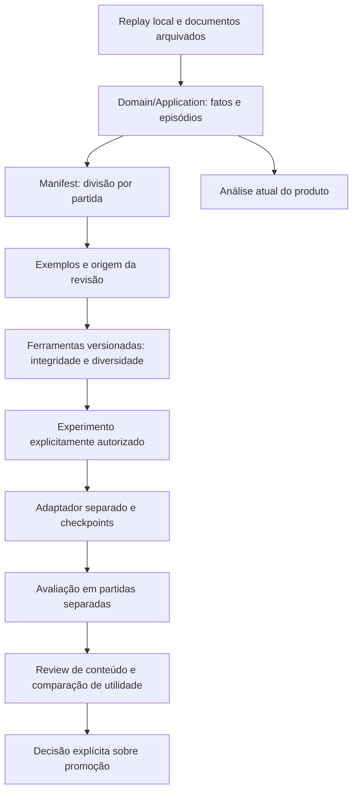
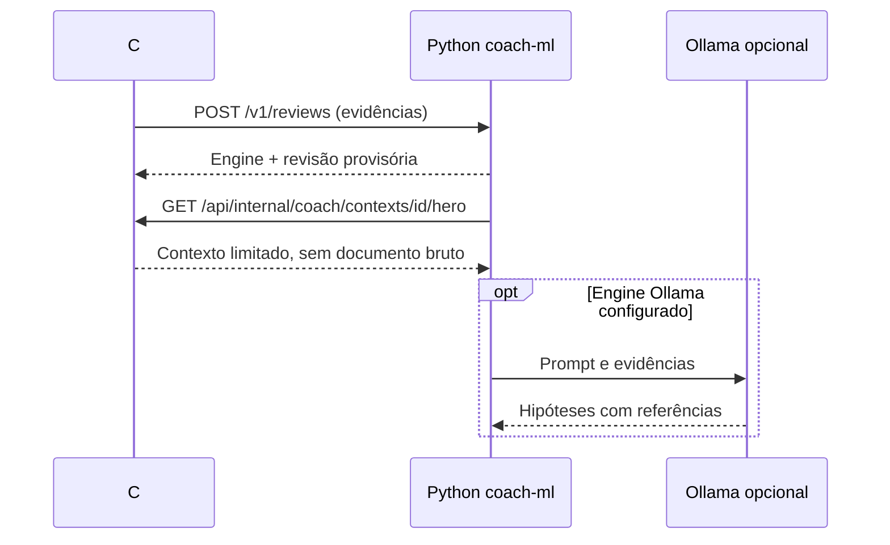

# Estrutura de aprendizado do coach

A análise do produto e o aprendizado experimental são fluxos separados. Domain/Application continuam responsáveis por converter o replay em fatos, episódios e observações com limitações; ferramentas de treino não alteram estatísticas nem os contratos usados pelo React.

O projeto [coach-ml](../coach-ml/README.md) contém auditoria, curadoria, treinamento e avaliação, com CLI instalável e dependências de ML opcionais. Auditoria e curadoria usam biblioteca padrão e rodam somente em CPU.

`audit-experiment` compara também entradas idênticas entre treino e validação. `deduplicate` produz um novo conjunto mantendo cobertura das partidas e os originais. `token-budget` usa um tokenizer local fixado para detectar limites de entrada/saída sem carregar pesos. `evaluate` confere identidade e truncamento das previsões e relata desempenho por competência; não altera o status do treino. O congelamento de futuros treinos registra código, dados, pesos-base e versões do ambiente instalado.

O perfil Docker coach-ml oferece um serviço HTTP autenticado. C# monta os contextos a partir de replays arquivados e pode pedir revisões ao Python; Python pode buscar contextos no C# por callback fixo. Esse fluxo usa rotas internas e chave de máquina, separado da sessão Steam e das dicas públicas.

O padrão policy-preview é uma política explícita em CPU; não significa que o modelo treinado foi implantado. Ollama é configurável no Python. O C# valida novamente as referências e mantém regras/cálculos no domínio. O treinador Python tem congelamento próprio de dados/código/pesos/ambiente, cache offline, checkpoints com manifesto SHA-256 e validação dos prefixos de previsões antes da inferência. Experimentos antigos preservam seus runtimes originais; checkpoints sem selo não são migrados automaticamente.

O experimento factual concluído reproduziu os alvos em 288/288 casos de 96 partidas, mas ensinava somente dois exercícios fixos. Esse resultado fundamenta extração/contrato, não decisão tática. A política contextual opt-in `reviewPolicyVersion: 2` mantém as seis competências e liga exercícios a registros/instantes verificáveis. O padrão v1 permanece disponível para preservar os conjuntos anteriores. No registro de 18/10/2026, o novo treino com 34.827 exemplos está pausado a pedido do usuário; não há promoção do adaptador ao serviço. O README registra o recorte e suas limitações; datasets e relatórios privados não são publicados.

O manifest separa partidas inteiras antes da construção do SFT. Cada exemplo mantém identidade da cena, hash da fonte e origem do alvo. Treino, validação e teste não compartilham perspectivas da mesma partida. A ferramenta detecta partição indevida e metadados divergentes; a integridade do manifest e dos replays continua sendo responsabilidade do congelamento da extração.

Há quatro verificações diferentes:

| Verificação | O que estabelece |
|---|---|
| Integridade | IDs, partições, hashes declarados, alinhamento e referências coerentes |
| Fidelidade factual ao input | Observação corresponde aos valores recebidos, sem snapshot futuro |
| Diversidade | Quantos inputs, alvos e exercícios diferentes existem; volume não equivale a competências |
| Qualidade tática | Requer avaliação de conteúdo e utilidade; não é concedida por formato, loss ou contagens |

Um alvo provisório do assistente continua provisório depois de passar na auditoria. Campos como `trainingEligibilityGranted=false` impedem interpretar o relatório como autorização automática. Experimentos com rótulos provisórios exigem escopo explícito e não promovem o candidato ao produto.

O dado na âncora e o resultado retrospectivo mantêm significados distintos. Posições oniscientes não são visão do jogador; compras não provam inventário entregue; upgrades não provam cooldowns. O auditor da revisão factual não reabre o `.dem` e não detecta toda contradição em prosa livre. Essas limitações precisam acompanhar a avaliação, além de qualquer score numérico.

No currículo de competências, o texto também precisa respeitar a natureza do registro: um upgrade pode representar habilidade ativa, passiva ou talento, sem comprovar oportunidade de lançamento. Uma cena no início da partida pode não ter os dez segundos anteriores necessários à comparação de separação. A tarefa de cobertura usa identidades e horários das amostras, sem coordenadas para afirmar distâncias. Reviews de amostras reais devem verificar esses limites além da validação estrutural.

Código e documentação são versionáveis. Dados privados, conjuntos locais, pesos, credenciais e relatórios ficam em `work/` e não devem ser incluídos em commits. Um treino ativo usa seu próprio congelamento; novas ferramentas podem auditá-lo em leitura, mas não substituem seus scripts, entradas ou avaliação durante a execução.
